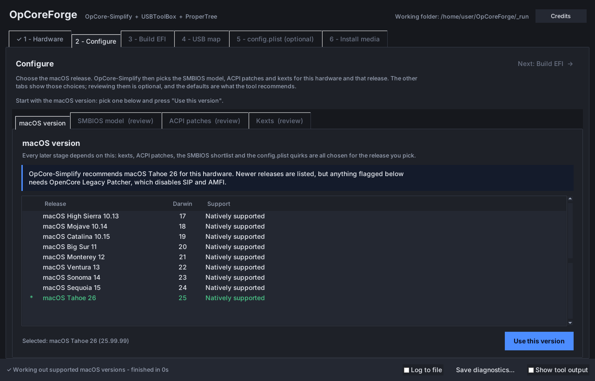
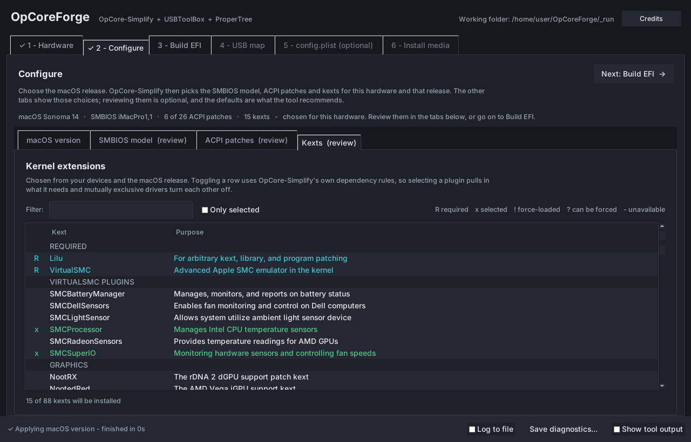
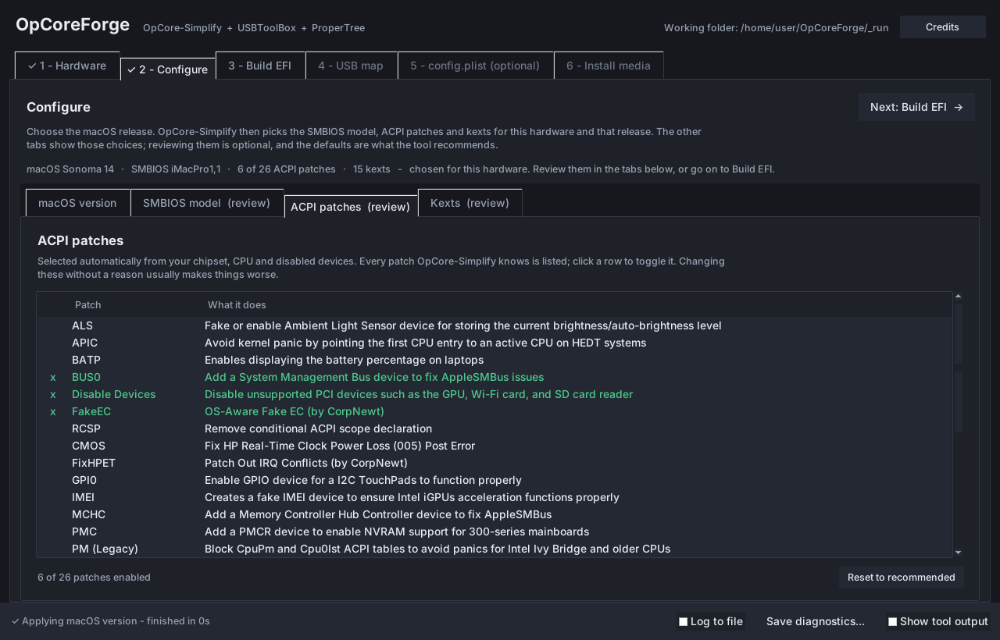
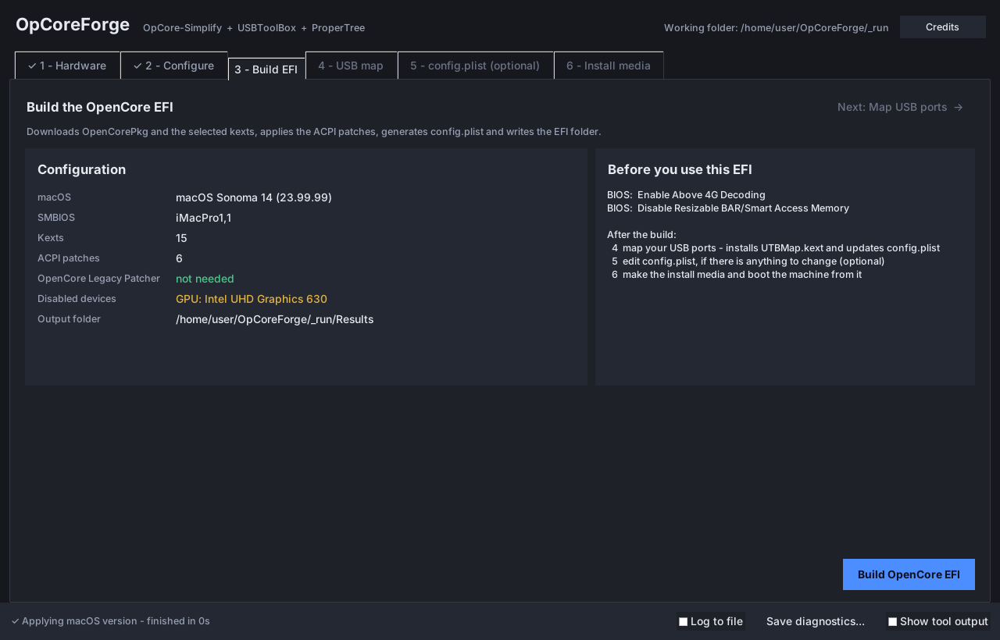
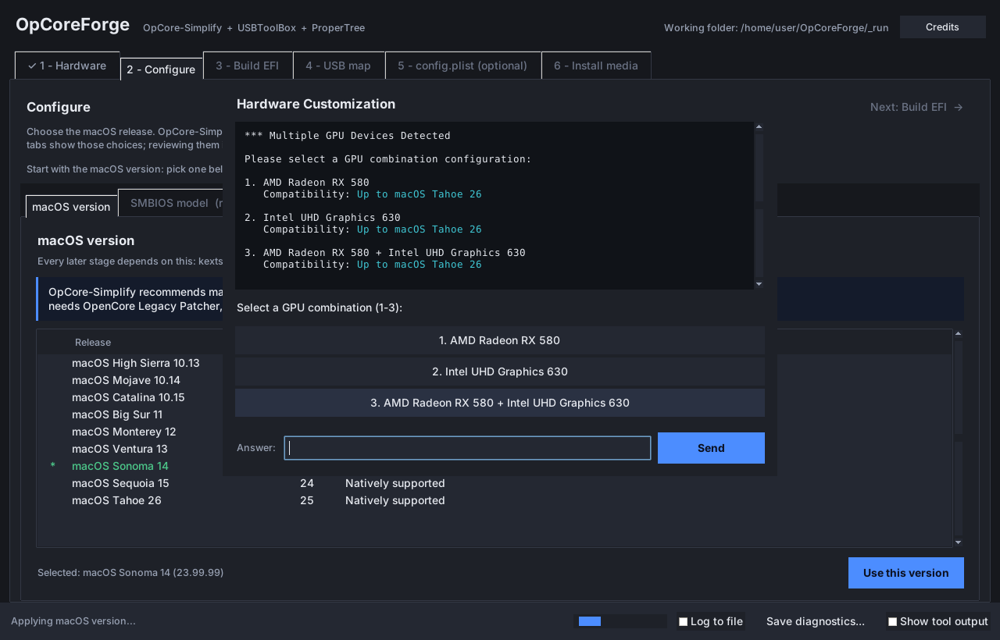

# OpCoreForge

OpCore-Simplify, USBToolBox and ProperTree combined into one portable Windows
executable, driven by a GUI that runs them in the order they actually have to
run in.

> **Two halves, one per operating system.** OpCoreForge itself runs on
> **Windows** and nowhere else. It is the *preparation* step for installing
> macOS on hardware Apple does not support: you run it on a Windows PC —
> ideally the target machine itself, so it can read that machine's hardware and
> USB ports — to build the OpenCore EFI and the macOS install media. macOS is
> then installed by booting the target machine from that media.
>
> **OpCoreForge Companion** is the other half: a small **macOS** app that comes
> on the same USB stick and runs on the target machine once macOS is installed.
> It puts OpenCore onto the machine's own disk, so the stick is no longer needed
> to boot it. See [After macOS is installed](#after-macos-is-installed-opcoreforge-companion).

Each of the three does one part of building a working OpenCore EFI, and
OpCore-Simplify ends by telling you to go and do the other two by hand:

> \* USB Mapping:
>     - Use USBToolBox tool to map USB ports.
>     - Add created UTBMap.kext into the EFI\OC\Kexts folder.
>     - Remove UTBDefault.kext in the EFI\OC\Kexts folder.
>     - Edit config.plist:
>         - Use ProperTree to open your config.plist.
>         - Run OC Snapshot by pressing Command/Ctrl + R.

OpCoreForge turns that closing instruction into stages 4 and 5 of the same
program, and does the file shuffling itself.

---

## What it looks like

Six tabs, left to right, each unlocking the next, with a **Next** button on
each. A stage gets a tick when its own work is done, and the status bar says
what just happened and how long it took rather than going back to "Ready".



Every release the hardware can run, with the ones needing OpenCore Legacy
Patcher flagged — the choice everything downstream depends on.



All 88 kexts by category with upstream's own status markers. Toggling a row
runs OpCore-Simplify's dependency rules, so selecting a plugin pulls in what it
needs and mutually exclusive drivers turn each other off.



The 26 ACPI patches with the recommended set already chosen, and
[the SMBIOS shortlist](docs/screenshots/02-smbios.png) behind a toggle that
opens the full 77-model catalogue.



What is about to be built, and what the target machine's firmware needs changed
before it will boot.



Upstream asks questions from inside its own code, at a terminal that is not
there any more. Every one of them is surfaced as a dialog instead of being
answered silently — which is the difference between a tool that makes your
choices and one that asks.

These are captured from the running application by `tools/test_gui.py`, which
drives it against the synthetic hardware report `tools/make_fixture.py`
produces — a Comet Lake i9-10900K that does not exist — and published by
`tools/make_shots.py`, which only crops them to the window. Nothing is mocked
up or retouched: it is the real window rendering real data.

---

## Getting it

Download **`OpCoreForge.exe`** from the
[latest release](https://github.com/KurdtNervanna/OpCoreForge/releases/latest)
and run it; there is nothing to install. The macOS companion,
`OpCoreForge-Companion.dmg`, is attached to the same release, and stage 6 puts
it on the install media for you.

## Building the executable

To build it yourself instead, on the Windows machine, with [Python 3.9+](https://www.python.org/downloads/)
installed ("Add python.exe to PATH" ticked):

```
BUILD_EXE.bat
```

That is the whole procedure. It creates a local virtual environment, installs
PyInstaller and pywin32 into it, downloads the OpenCore payload to bundle, and
writes **`dist\OpCoreForge.exe`** — one file, roughly 100 MB, that you can copy
anywhere and double-click.

To confirm a build is complete:

```
OpCoreForge.exe --self-test
```

It checks that all three projects load side by side, that every data file each
of them reads at runtime is in the bundle, that the data folder is writable and
that the config.plist editor still embeds. Anything missing is named.

The icon is `assets/OpCoreForge.png`; `build/OpCoreForge.ico` is generated from
it by `python build/make_icon.py` at seven sizes and is committed, because the
Windows machine that runs `BUILD_EXE.bat` has no Pillow and an executable
missing its icon over a build dependency is a silly way to lose it. The window
uses the `.ico` on Windows and the PNG everywhere else, since Tk cannot read an
`.ico` off Windows.

---

## Using it

**Run it as administrator.** Right-click › Run as administrator. Two stages
need it: stage 1 dumps this PC's ACPI tables, which Windows only hands to an
elevated process, and stage 4 reads USB port properties and silently reports
fewer ports without it. OpCoreForge checks at startup and offers to restart
itself elevated if it is not.

Six tabs, unlocked as their inputs appear.

| Stage | Tool | What happens |
|---|---|---|
| 1 Hardware | OpCore-Simplify | Run Hardware Sniffer, or import a `Report.json` + ACPI folder. Shows the compatibility report. |
| 2 Configure | OpCore-Simplify | The macOS release — every one from High Sierra to Tahoe, flagged where OpenCore Legacy Patcher would be required — and one line saying what it chose. Three tabs underneath review those choices, and are optional: the **SMBIOS** model (the full 77-model catalogue behind a toggle), the 26 **ACPI** patches, and the 88 **kexts** by category with upstream's `R / x / ! / ? / -` markers. |
| 3 Build EFI | OpCore-Simplify | Downloads OpenCore + kexts, applies patches, generates config.plist, writes the EFI. |
| 4 USB map | USBToolBox | Live port discovery, connector types, comments; builds `UTBMap.kext` **and installs it into the EFI, removing `UTBDefault.kext` and rewriting `Kernel -> Add` to match**. |
| 5 config.plist | ProperTree | Optional. The full editor, inside the tab (with its own window as the fallback, see below); OC Snapshot already knows which OC folder to scan. |
| 6 Install media | — | What was built and what the machine needs (BIOS settings, the EFI checked against its own `config.plist`, what to do after the install); then one button that downloads a macOS recovery and puts it with the EFI, written to a USB drive or an ISO for a VM. Adds the companion app for after the install. |

Everything lives beside the executable:

```
OpCoreForge.exe
OpCoreForge_Data/
    Results/        the EFI folder that was built
    OCK_Files/      OpenCorePkg + kext cache
    SysReport/      Hardware Sniffer output
    USBMap/         usb.json, settings.json, UTBMap.kext
    ProperTree/     editor settings, Configuration.tex
    bin/            iasl.exe, macserial.exe, Hardware-Sniffer-CLI.exe
    Companion/      the companion disk image, as downloaded for the media
    logs/
```

If the folder holding the .exe is not writable, it falls back to
`%LOCALAPPDATA%\OpCoreForge` and says so in the title bar area.

---

## The install media

Stage 6 makes a macOS **Recovery** installer: the machine boots into Recovery
through OpenCore and downloads macOS from Apple during setup. A full offline
installer cannot be built on Windows at all — Apple's `createinstallmedia` is a
macOS binary writing an APFS volume — which is why OpenCore Legacy Patcher can
offer one and this cannot. The macOS you end up with is the same.

The recovery itself is downloaded by **OpenCore's own `macrecovery.py`**,
extracted from the OpenCorePkg release — whose zip is checked against the
SHA-256 Dortania's build index (or the release page) publishes for it. Apple's recovery protocol is
undocumented and moves; reimplementing it would be a quiet way to fetch the
wrong thing.

The board ID is what tells Apple which macOS to send, and it follows **the
release chosen in stage 2, not the SMBIOS the EFI presents** — those are
routinely different. A MacBookPro10,1 is a sensible SMBIOS for an Ivy Bridge
laptop and a useless board for anything past Catalina, so asking for Sequoia
with it returns Catalina, silently. Stage 6 therefore lists only Macs whose
board reaches the chosen release, preferring the stage 2 SMBIOS when it
qualifies and saying so when it does not. The model-to-board table in
`boards.py` is transcribed from [Dortania's SMBIOS support
page](https://dortania.github.io/OpenCore-Install-Guide/extras/smbios-support.html);
which releases each board covers comes from OpCore-Simplify's own model data.
Neither half is written from memory.

The `config.plist` **on the media** is adjusted for installing: auxiliary
entries shown, a longer picker timeout, and everything scanned. macOS Recovery
is an auxiliary entry, and OpenCore's sample config hides those — sensible on
an installed machine, and on an installer it hides the only thing you booted
the stick for, leaving a picker that looks empty. The EFI in `Results` is left
alone, because that one is for the machine once macOS is on it.

Before any of that is copied, the EFI is checked against its own
`config.plist`. OpenCore halts on a critical error if `Kernel -> Add` names a
kext the folder does not have — or `ACPI -> Add` a table, or `UEFI -> Drivers`
a driver — and it halts *after* the picker has drawn, which reads as "macOS
will not boot" rather than "a file is missing". `eficheck.audit` walks every
section that names a file and `eficheck.repair` drops the entries that point at
nothing, which is what OC Snapshot would have done. It is the last moment
before a USB stick is written, and each repair is reported rather than done
quietly.

Three outputs, all from one folder so the safe path always exists:

**Get macOS and prepare** does both halves in one go: it downloads the
recovery for the chosen Mac model — skipping that if the recovery on disk is
already for the same model — and lays out the folder. From that folder:

- **The folder.** `OpCoreForge_Data\InstallMedia` holds `EFI\`,
  `com.apple.recovery.boot\` and `OpCoreForge\`. Format a USB stick as FAT32
  and copy all three across; that is the whole procedure.
- **The USB.** The only thing here that can destroy data, so:
  - **USB drives only**, decided by the bus Windows reports the disk on, not
    by what the drive says about itself. Internal SATA, NVMe, SAS and RAID
    disks are never listed and are refused if one is passed in anyway; no
    setting changes that. (A card in a built-in reader is offered when the
    reader is USB-attached, as many are, and not when it sits on the SD/MMC
    bus — which is also where eMMC laptops keep Windows.)
  - **USB sticks by default.** USB hard drives and external SSDs appear when
    **List USB hard drives** is ticked, as in Rufus, including UAS enclosures
    that report themselves as SCSI. Erasing one asks a second time and lists
    every partition on it, with its label and how much is in use.
  - **Never** disk 0, the disk Windows boots from or keeps its system
    partition on, a disk holding the system or program drive, or a disk with
    a Windows installation on any partition (Windows To Go lives on USB).
  - The drive has to be named back in the confirmation before anything runs,
    and after formatting the new volume is found on *that* disk — not by
    searching for its label, which a second OpenCore stick would also carry.
  - Windows will not format FAT32 past 32 GB, so on a larger drive the media
    gets a 16 GB partition and the rest is left unallocated.

  The `diskpart` script is built by a pure function, logged before it
  executes, and asserted on in tests without a disk present. When Windows
  answers "Access is denied" — something still has a just-inserted drive
  open, such as AutoPlay or an antivirus scan — the same script is run again
  after a pause, up to three times, before the error is shown.
- **The ISO.** For VMs. A UEFI machine boots an ISO through an El Torito
  catalog entry pointing at a FAT image the firmware mounts as an EFI System
  Partition, so the media goes into a FAT32 image — written from scratch,
  because Windows ships nothing that makes one — which is then wrapped in
  ISO9660. The test suite walks that chain in the finished file and reads the
  boot image back with mtools. You choose where it is saved, and the free
  space is checked first: the boot image and the ISO exist at the same moment,
  so it wants roughly twice the size of the media.

### Knowing that something is happening

Three of these steps copy gigabytes and two of them do it twice. A window that
says nothing for four minutes is indistinguishable from one that has died, so:

- Every long operation takes a `progress(done, total)` callback — the FAT
  image writer, the ISO writer (through the file object pycdlib writes to,
  since it offers no hook of its own), staging the folder, and the USB copy.
  The status bar shows a real percentage, throttled to ten updates a second so
  a 3 GB copy does not hand three thousand callbacks to the main thread.
- The status line carries a clock once a step passes two seconds, and ends on
  `✓ <what it was> — finished in 2:41` rather than "Ready", which looked the
  same whether something had finished, been skipped, or never run.
- A finished stage gets a tick on its tab. Stages unlock only when the one
  before them is done, so that is where the mark comes from.
- Writing a USB flushes Windows' write cache before saying it is finished,
  because "copied" and "safe to unplug" are not the same moment.

---

## After macOS is installed: OpCoreForge Companion

Until OpenCore is on the machine's own disk, the machine only starts macOS with
the USB stick plugged in. Doing that by hand means mounting a hidden EFI
partition from Terminal and copying the right folders onto it without
disturbing the ones Windows needs. The companion does it with one button.

**Getting it.** Stage 6 puts an `OpCoreForge` folder on the install media:

```
OpCoreForge/
    OpCoreForge-Companion.dmg   the macOS app
    EFI/                        the EFI exactly as built, for the internal disk
    media.json                  which OpCoreForge made the stick, and when
    READ ME.txt
```

Once macOS is up, open the stick in Finder, open the disk image and run
**OpCoreForge Companion**. It is also attached to every
[release](https://github.com/KurdtNervanna/OpCoreForge/releases).

The second `EFI` is the point of that folder. The one at the root of the stick
has the install settings described above (recovery shown, a long timeout),
which are wrong for an installed system; this copy has none of them, and it is
what the companion offers first. A stick made by an older OpCoreForge has only
the root `EFI`, and the companion can still install that.

**What it does.**

1. Works out which disk macOS is on (through the APFS container to the
   physical disk behind it) and lists that disk's EFI partition first. Only
   internal disks are offered as the destination: the point is to stop needing
   a USB stick, so offering one would be a trap. It also shows which partition
   OpenCore started from, read from OpenCore's own `boot-path` NVRAM variable.
2. Checks the EFI with the same `eficheck.audit` stage 6 uses, and refuses one
   OpenCore would halt on.
3. Sets `Misc -> Boot -> LauncherOption` to `Full` in the copy it installs, so
   the first time OpenCore starts from the internal disk it adds its own entry
   to the firmware's boot menu and keeps it at the top. That is what replaces
   "boot from the USB stick". A value set on purpose is left alone, and the
   checkbox turns this off.
4. Asks for the administrator password once, then backs up the partition's
   whole `EFI` folder to `~/Library/Application Support/OpCoreForge
   Companion/EFI backups/` and replaces **only** `EFI/OC` and `EFI/BOOT`.
   `EFI/Microsoft` and anything else on the partition is left exactly as it
   was, so a disk shared with Windows still starts Windows.
5. If any copy fails, puts the previous `OC` and `BOOT` back before it exits.
   A partition without room is refused before anything is touched.

After that: shut down, unplug the stick, and start the machine from the
internal disk — pick it in the firmware's boot menu the first time.

The script that runs as root is built by a pure function and shown in the log,
like the `diskpart` script. `tools/test_companion.py` runs it against folders
standing in for EFI partitions, with stand-ins for `diskutil` and `ditto`, to
prove the backup comes first, Windows survives and a failed copy is undone.

The companion can also **copy itself into Applications**, so it is still there
once the stick goes back in a drawer.

**Opening it.** Copied off a stick written on Windows, the app carries no
quarantine flag and opens with a double-click. Downloaded on the Mac through a
browser, it is unsigned, so the first time it needs right-click › Open (on
Sequoia and later: System Settings › Privacy & Security › Open Anyway).

**Building it.** It has to be built on a Mac, so GitHub Actions does it
(`.github/workflows/companion.yml`, an Intel runner): the tests, a PyInstaller
build from `Companion.spec`, a self-test of the finished app, and the disk
image. The release workflow (see [Releases](#releases)) attaches
`OpCoreForge-Companion.dmg` to every release it makes, and a release published
by hand gets it a few minutes later, which is where stage 6 downloads it from:
first the release matching its own version, then the latest, checking it
against the SHA-256 GitHub publishes for the file. Only if GitHub's API cannot
be reached is it downloaded unchecked, and the log says so. A `.dmg` dropped into
`OpCoreForge_Data\Companion` by hand is used as it is. To build one on a Mac
yourself, use Python from python.org (it targets macOS 10.13 and bundles Tk):

```
python3 -m pip install pyinstaller certifi pillow
python3 -m PyInstaller --clean --noconfirm Companion.spec
```

**Not yet.** Updating OpenCore and kexts on the installed EFI, and
post-install patches for hardware that needs them, are planned for the
companion and not in it today.

---

## How the three are integrated

The design rule throughout: **OpCoreForge never re-implements a decision.**
Every compatibility check, kext dependency resolution, SMBIOS suggestion, ACPI
patch, config.plist rule, USB matching key and plist edit is executed by the
original upstream code. Only the terminal menus on top of them were replaced.

**Nothing in `src/vendor/` is hand-edited.** `build/vendor.py` performs one
mechanical transformation and asserts every rule it applies; behavioural changes
all live in `src/opcoreforge/patches.py`, so pulling a newer upstream release is
one command and cannot silently drop a fix.

### 1. Three packages called `Scripts`

All three projects ship a top-level package literally named `Scripts`. Only one
can win `sys.modules["Scripts"]`, and the other two then silently import the
wrong files. `build/vendor.py` renames them to `ocs_scripts`, `utb_scripts` and
`pt_scripts` and rewrites the imports, failing loudly if upstream's layout has
moved.

### 2. Paths that assume a source directory

Each tool resolves its working files relative to its own source folder —
`OCK_Files`, `Results`, `usb.json`, `UTBMap.kext`, `iasl.exe`, ProperTree's
`settings.json`. Inside a one-file build that folder is a temp directory deleted
on exit, so a naive bundle re-downloads OpenCore on every launch and loses your
port map.

All of those paths derive from the module's own `__file__`, so `patches.py`
reassigns `__file__` on the imported module. One line relocates every path that
module computes, with no forked code to keep in sync:

```
<data>/bin/kext_maestro.py   ->  dirname(dirname(f))  ->  <data>/OCK_Files
<data>/bin/smbios.py         ->  dirname(f)           ->  <data>/bin/macserial.exe
<data>/ocs_main.py           ->  dirname(f)           ->  <data>/Results
```

### 3. Questions asked from inside the logic

OpCore-Simplify's analysis and its terminal UI are interleaved:
`select_required_kexts` stops mid-analysis to ask which Intel Wi-Fi kext to use;
`hardware_customization` asks which GPU combination to enable; there are a
couple of dozen such prompts across ~15k lines.

Rather than fork that logic, `bridge/console.py` replaces the primitives every
prompt goes through — `Utils.head`, `print`, `Utils.request_input`. Any prompt
anywhere, **including ones added by a future upstream release**, surfaces as a
dialog showing the exact text upstream intended, with its numbered options
turned into buttons and a free-text field as the fallback. Nothing is answered
on your behalf; only "press Enter to continue" is acknowledged automatically,
and that text still appears in the tool output pane.

The same trick handles USBToolBox: `TUIMenu` and `TUIOnlyPrint` are swapped for
scriptable stand-ins, so upstream's `build_kext` — the part that must be exactly
right — runs unmodified with its three terminal prompts pre-answered.

### 4. ProperTree inside a tab

ProperTree is a whole Tk application: it owns a root, builds a window per
document, installs app-wide keybindings and runs its own mainloop. Four things
let it live in a notebook tab with everything intact:

- **A stand-in root.** ProperTree packs its hex/Base64 converter widgets
  directly into its Tk root, so handing it the real application window would
  scatter them across the UI. `tkinter.Tk` is briefly redirected to return a
  dedicated hidden `Toplevel` instead — which is also exactly what Ctrl+T then
  shows. Its `mainloop()` call is suppressed so control returns.
- **A container frame.** The tab holds a frame created with `-container`, and
  ProperTree's document window is *created inside it* with `-use` — Tk's own
  mechanism for hosting one top-level inside another, on Windows and X11. Tk
  sizes the window to the frame; the window-manager calls ProperTree makes on
  it are ignored, and the two that misbehave (withdraw, deiconify) are
  shimmed. Where Tk has no containers (macOS), the older route is used: the
  window is created as a child of the tab and demoted with `wm forget`.
- **A redirected `stackorder`.** Every ProperTree menu command resolves its
  target with `stackorder(...)[-1]`, and `wm stackorder` cannot see a forgotten
  window — so without this override, Ctrl+R and friends would silently do
  nothing.
- **No titlebar tinting on the embedded window.** ProperTree keeps its window
  titlebars in step with the system dark mode by handing each window's handle
  to `DwmSetWindowAttribute`. That API is defined for top-level windows only;
  the embedded document is a child window, and passing its handle faults inside
  `dwmapi` — an access violation, so upstream's `except:` never sees it and the
  process simply dies. The embedded window is marked as such and skipped (a
  container-held window still *reports* `"wm"` as its manager, so that alone
  is not enough), and the real top-levels keep the feature.

**Why a container, and what happens if it still fails.** Up to 1.3 the
editor was demoted with `wm forget` on Windows too, and on the machine this was
reported from that faulted inside Tk's own code three times — in three
different calls, every one while the first document was being opened, each
after a fix that removed the previous one. An access violation is not a Python
exception: there is nothing to catch and the process simply vanishes. So
Windows opened the editor in its own window instead. A container frame never
converts a window after the fact, which is the step those faults all followed,
so from 2.1 the tab is the default on Windows again.

The window remains the safety net. A marker file is written just before the
editor is built and removed once it is up, so a run that dies is noticed on the
next launch and the editor opens in its own window instead, with the reason on
screen. Everything that makes it part of OpCoreForge is the same either way —
the same document, the same toolbar, OC Snapshot still pointed at the EFI
stage 3 built. The **Own window** checkbox on stage 5 switches between the two
and is remembered.

Its self-updater is removed: it spawns `sys.executable Scripts/update_check.py`
through `multiprocessing`, and inside a one-file build `sys.executable` is
OpCoreForge itself, so that would relaunch the whole application. (It is reached
synchronously from `__init__`, so the class is patched before construction.)

### 5. One pump, and no worker thread ever touches Tk

Tkinter is not thread-safe. The usual shortcut — calling `root.after()` from a
background thread — appears to work, but every call has to be serialised
against the main thread. Measured on the log path it cost about **40 ms per
call**, and OpCore-Simplify's download progress bar prints four times per
chunk: detection took *minutes* and the window looked hung.

So background threads never touch Tk. They push callables onto a plain
`queue.Queue` and the Tk thread drains it every 30 ms (`MainThreadPump`).
Console output is not even posted per write — the worker appends to a buffer
and the pump flushes it in one widget update per tick:

| pushed through the log path | before | after |
|---|---|---|
| 2,000 writes | 83.6 s | 0.00 s |
| 20,000 writes | did not finish | 0.03 s |

The log pane also emulates carriage returns, so a progress bar renders as one
line that updates in place instead of thousands of near-identical lines.

A related trap: `ProperTree.__init__` calls `update()` while laying out its
first document, so any pending callback can re-enter the code that is building
it. Both the config stage and the editor wrapper guard against being asked to
start a second editor mid-construction.

### 6. Two improvements over running the tools separately

- **OC Snapshot knows where to look.** Standalone ProperTree asks you to find
  the OC folder. Here it is the EFI stage 3 just built, so the picker is
  answered automatically.
- **A dead download no longer costs the whole build.** Upstream aborts the
  entire gather run if one asset is unreachable. OpCoreForge names the kext and
  offers to continue without it, so a single kext host being down does not mean
  "no EFI at all".

---

## Versions

Every delivered build gets its own version, so two builds are never
confusable. It appears in four places:

```
title bar                     OpCoreForge 2.1.3
OpCoreForge.exe --version     OpCoreForge 2.1.3
OpCoreForge.exe --self-test   OpCoreForge 2.1.3 self test
Explorer > Properties         File version 2.1.3
```

`CHANGELOG.md` records what changed in each one. The version lives in exactly
one place, `src/opcoreforge/version.py`, and is bumped with:

```
python build/bump_version.py patch -m "What changed"     # a fix
python build/bump_version.py minor -m "What changed"     # new behaviour
python build/bump_version.py major -m "What changed"     # a rework
python build/bump_version.py --show                      # current version
```

That writes the new number and adds the changelog entry in one step, so the two
cannot drift apart. The .exe keeps its stable name — shortcuts and the data
folder stay put — and the release zip carries the version instead.

### Releases

A release is made by GitHub Actions, from **Actions › Release › Run workflow**
on `main` (`.github/workflows/release.yml`). It reads the version from
`version.py` and refuses to run if that release already exists, so bump first.
Then it:

1. builds `OpCoreForge.exe` on a Windows runner the way `BUILD_EXE.bat` does,
   bundled payload included, and runs the finished executable's `--self-test`;
2. builds `OpCoreForge-Companion.dmg` with `companion.yml`;
3. creates the release `v<version>` with both attached. The notes are taken
   from `CHANGELOG.md` by `build/release_notes.py` and cover every version
   since the last published release, not just the newest.

## Keeping up with upstream

```
python build/vendor.py          # re-clone and re-apply the renames
python build/make_seed.py       # refresh the bundled payload
BUILD_EXE.bat --skip-seed       # rebuild
```

`vendor.py` asserts every rewrite it makes. If upstream restructures something,
vendoring fails with the rule that stopped matching rather than producing a
build that is broken in a subtle way. `src/vendor/*/UPSTREAM.txt` records the
commit each tree came from.

Verified against:

| Project | Commit |
|---|---|
| lzhoang2801/OpCore-Simplify | `e5d8a9f551b1` |
| USBToolBox/tool | `0c6823a2c643` |
| corpnewt/ProperTree | `51ed53dbe3c9` |

---

## Testing

```
python tools/make_fixture.py      # synthetic Comet Lake report + compiled DSDT
python tools/test_workflow.py     # 49 checks: report -> EFI -> USB map -> snapshot
python tools/test_gui.py          # 66 checks driving the real window, with screenshots
python tools/test_embed.py        # 2 x 37 checks: the ProperTree embedding, container and wm forget
python tools/test_editor_window.py # 18 checks on the editor as its own window
python tools/test_unsupported.py  # 16 checks: a refusal must be visible, not silent
python tools/test_nvidia_driver.py # 32 checks: NullMoth NVIDIA driver on Sequoia
python tools/test_netdiag.py      # 31 checks: name the real cause of a failed download
python tools/test_gpu_ceiling.py  # 24 checks: refuse macOS no GPU here can drive
python tools/test_diagnostics.py  # 75 checks: session log, frozen paths, COM, elevation
python tools/test_pump.py         # 21 checks: the pump under a nested event loop
python tools/test_fatimage.py     # 27 checks: the FAT32 writer, read back by mtools
python tools/test_isoimage.py     # 18 checks: the ISO's UEFI boot chain, byte by byte
python tools/test_media.py        # 110 checks: boards, the recovery pipeline, every USB refusal
python tools/test_companion.py    # 90 checks: macOS disks, the root install script run for real, the media
python tools/test_eficheck.py     # 53 checks: config.plist must not name a file the EFI lacks
python tools/test_progress.py     # 44 checks: progress, elapsed time, completion marks
python tools/test_buildbat.py     # 15 checks on BUILD_EXE.bat, under a real cmd.exe
python tools/bench_detect.py      # times the log path and ACPI parsing
python tools/bench_logpane.py     # isolates the per-write cost of the log pane
```

`test_workflow.py` builds a genuine EFI end to end — real SSDTs compiled by
iasl, a real config.plist with a generated serial, a real `UTBMap.kext` — then
loads it into the embedded editor and verifies OC Snapshot picks up the USB map
and drops the placeholder. On Linux, run them under `xvfb-run`.

---

## Reporting a bug

The status bar has **Save diagnostics...**. It writes one file containing the
build version, this PC's details (OS, Python, whether it is running elevated,
the clock), the hardware it detected, and everything the three tools printed
this session. Send that file.

It works after the fact: the session is recorded in memory from the moment the
window opens whether or not anything is switched on, so the crash that just
happened is already in it. A crash that kills the process outright leaves no
Python traceback at all, so `faulthandler` writes the native stack of every
thread to `OpCoreForge_Data\logs\crash.log` — send that too if the window
disappears. **Log to file** next to it mirrors the same content
to `OpCoreForge_Data\logs\` as it happens, which is the one to use for a
failure that takes the application down before a dialog can be read.
`OpCoreForge.exe --log` starts with it on.

---

## Notes and limits

- **The macOS list is wider than what will actually work.** OpCore-Simplify
  offers the union of every device's support range, so one component with a
  long life — a Broadcom Wi-Fi card that OpenCore Legacy Patcher carries to the
  newest release — stretches the list past what the graphics can drive.
  OpCoreForge marks those rows and refuses them, naming the GPU and the newest
  release it can display; chosen anyway, upstream disables every GPU and the
  next step dies reading an empty list.
- **NVIDIA Turing and newer can reach Sequoia.** To Apple these cards have no
  driver, so upstream dead-ends on them. The
  [NullMoth driver](https://github.com/nullmoth/nvidia-macos-driver) is a Metal
  driver that runs them on macOS 15 Sequoia through OpenCore configuration, and
  when such a card is the only reason a machine would be refused, OpCoreForge
  offers it: say yes and the EFI is built for Sequoia with the driver's
  settings written in. Say no and the machine is refused with a plain reason
  that names the card. The kexts are not in the EFI — they install after macOS
  is up. [`docs/NVIDIA-DRIVER.md`](docs/NVIDIA-DRIVER.md) has the detail, and
  the driver is PolyForm Noncommercial (personal / research / non-profit use).
- **OpCoreForge runs only on Windows; the companion only on macOS.**
  Hardware Sniffer is a Windows
  binary, USB port discovery reads live PnP data through WMI, the ACPI dump
  needs an elevated Windows process, and the USB writer uses `diskpart`. Much
  of the Python underneath happens to be cross-platform — which is what lets
  the test suite run under `xvfb-run` on Linux — but that is a development
  convenience, not a way to use OpCoreForge. Run it on Windows, preferably on
  the machine macOS is going onto; if that is not possible, stage 1 can import
  a `Report.json` and stage 4 a `usb.json` captured on the target machine.
- **The bundled payload is a starting point, not a pin.** After unpacking it
  once, OpCore-Simplify's own update logic takes over unchanged — release ids
  compared against `history.json`, SHA-256 verified, anything stale
  re-downloaded.
- **`certifi` is bundled deliberately.** OpCore-Simplify looks for the
  platform's CA bundle on disk and, not finding one (the normal case on
  Windows), falls back to certifi — and if that is absent too, to an
  *unverified* SSL context. Bundling it keeps kext downloads verified.
- This does not make a Hackintosh guaranteed to boot. It removes the file
  shuffling and the ordering mistakes; the
  [Dortania guide](https://dortania.github.io/OpenCore-Install-Guide/) is still
  the thing to read when something does not work.

## Credits and licences

All the real work belongs to the upstream authors. OpCoreForge is integration
code around them, and each project keeps its own licence in
`src/vendor/*/LICENSE`. **Credits**, at the top right of both apps, lists
them along with everyone who has contributed to OpCoreForge itself, read from
GitHub when it opens.

- [OpCore-Simplify](https://github.com/lzhoang2801/OpCore-Simplify) — lzhoang2801 — BSD 3-Clause
- [USBToolBox/tool](https://github.com/USBToolBox/tool) — dhinakg — MIT
- [ProperTree](https://github.com/corpnewt/ProperTree) — CorpNewt — BSD 3-Clause

OpCoreForge's own code — everything outside `src/vendor/` — is BSD 3-Clause;
see `LICENSE`. The same licence as two of the three upstreams, so the tree
reads under one set of conditions rather than a patchwork, and the MIT tree is
compatible with it. `THIRD-PARTY-NOTICES.md` has the whole picture: what is
redistributed, under which licence, from which commit, and what is downloaded
at run time instead of shipped.
